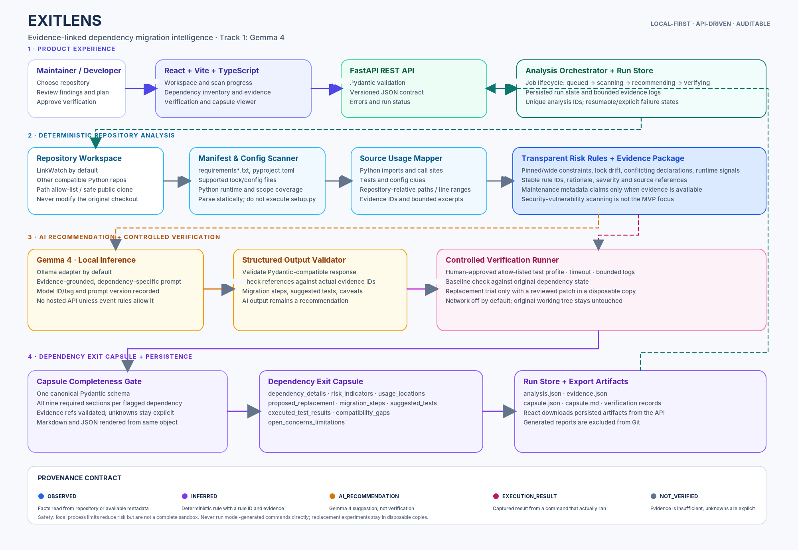

# ExitLens — Evidence-Linked Dependency Migration Intelligence

> **Track:** Gemma 4 — Dependency Resilience  
> **Target repository:** [`rishrek/LinkWatch`](https://github.com/rishrek/LinkWatch)  
> **Submission repository name:** `H26_<TeamName>_ExitLens`  
> **Status:** Implementation blueprint for the hackathon MVP. A feature is considered complete only after its code and tests exist; this README is the contract, not evidence that the implementation has already been built.

> **Starter archive note:** this ZIP contains the ExitLens project scaffold and requirements, not the original LinkWatch Git history or upstream source files. Run `powershell -ExecutionPolicy Bypass -File .\scripts\bootstrap.ps1` from the extracted folder. The script clones the official LinkWatch repository (or uses the existing checkout you pass), preserves its source and MIT license, saves its original README under `docs/upstream/`, and then overlays the ExitLens scaffold. It does not implement application logic.

ExitLens helps maintainers identify dependency-maintenance risks, understand real usage in a repository, plan replacements with **Gemma 4**, run safe and relevant checks where feasible, compare observed results, and export a reusable **Dependency Exit Capsule**.

Its core promise is simple:

**Repository inspection produces facts. Gemma 4 produces recommendations. The verification runner produces execution evidence. The capsule keeps those sources separate.**

---

## 1. Problem and solution

Dependencies can become difficult to maintain, deprecated, incompatible with a project's runtime, inconsistently declared, or expensive to replace. Version-update bots are useful, but a maintainer still needs repository-specific context: where a package is used, what a replacement would change, which checks ran, and which risks remain unresolved.

ExitLens combines five stages:

1. **Inspect:** parse supported manifests, lockfiles, Python configuration, source code and tests from the supplied repository.
2. **Assess:** generate transparent maintenance indicators from available evidence. Vulnerability scanning is not the focus of this challenge.
3. **Recommend:** use Gemma 4 to propose a replacement and migration plan grounded in the scanner's evidence.
4. **Verify:** run allow-listed baseline checks and, when a reviewed migration can safely be represented, replacement checks in a disposable workspace.
5. **Package:** export a versioned Dependency Exit Capsule in Markdown and JSON, including evidence, model provenance, results and limitations.

The product is repository-agnostic within its supported Python scope. LinkWatch is the mandatory acceptance target and default demonstration; its findings must be discovered at run time, never hard-coded.

## 2. Hackathon requirements and acceptance contract

The event handbook requires a public repository forked from the official starter, a working analysis of LinkWatch, an open-source license, setup documentation, actual execution evidence, and meaningful Gemma 4 integration. It also states that paid API usage and cloud services are prohibited. Accordingly, the **default model path is local Gemma 4 inference through Ollama**; do not use hosted inference unless the organizer explicitly confirms it is allowed.

| Requirement | ExitLens acceptance condition |
|---|---|
| Identify potentially at-risk dependencies | Every flagged dependency has one or more explicit, evidence-backed risk indicators. |
| Determine where/how dependencies are used | Usage records include repository-relative paths and line references where available. Static-analysis uncertainty is disclosed. |
| Propose replacements and migration approaches | Gemma 4 returns a structured, dependency-specific candidate, rationale, steps and suggested tests—or an explicit no-candidate/unavailable status. |
| Execute tests where feasible | Baseline and replacement attempts record the exact approved command profile, runtime, start/end time, exit code and bounded output. |
| Compare observed results | Compatibility gaps reference actual output or source evidence. A recommendation is never labelled verified merely because the model suggested it. |
| Generate a reusable capsule | Every flagged dependency has all nine required capsule sections, including explicit empty/not-assessed/not-run states. Markdown and JSON contain equivalent information. |

### Scope boundaries

**In scope for the MVP:** Python repositories, supported dependency manifests/lockfiles, static import/usage mapping, explainable maintenance rules, local Gemma 4 inference, controlled test execution, per-dependency migration plans, evidence provenance and capsule exports.

**Out of scope for the MVP:** vulnerability-first scanning, automatic production-code edits, automatic pull-request creation, arbitrary shell commands generated by the model, guaranteed drop-in replacements, every package ecosystem/language, cloud deployment, multi-user authentication and a production-grade sandbox.

> **Important:** “100% coverage” means all applicable output categories and required workflow stages are represented and tested. It does **not** mean every dependency has a replacement or every test passes. Missing or infeasible work must be explicitly reported.

## 3. Final architecture



Editable diagram source: [`docs/architecture.dot`](docs/architecture.dot) and [`docs/architecture.svg`](docs/architecture.svg).

### Runtime flow

1. The user submits a local repository path or an allowed public HTTPS Git URL.
2. The backend validates the input, creates an analysis ID, and prepares a disposable analysis workspace when cloning is required.
3. The scanner parses supported dependency declarations, lock information and project/runtime configuration.
4. The usage mapper searches Python source and tests, recording imports, paths, line ranges and evidence IDs.
5. The deterministic rule engine creates transparent risk indicators and a provenance-tagged evidence package.
6. The Gemma 4 adapter receives only relevant repository facts and code excerpts. It proposes replacements, ordered migration steps, suggested tests and optional patch proposals.
7. A validator parses the model's structured output, checks schema constraints and confirms that referenced evidence IDs exist. AI output stays classified as a recommendation.
8. A human approves an allow-listed test profile. Baseline checks and feasible replacement trials run in a disposable copy with timeouts and bounded logs.
9. The comparator records observed outcomes and gaps. The capsule completeness gate verifies every required field for every flagged dependency.
10. The run store persists the report and artifacts. React reads the same API data and offers Markdown/JSON downloads.

### Component ownership

| Component | Owns | Must not do |
|---|---|---|
| React frontend | User input, progress, selection, evidence views, approvals and downloads | Invent risk findings or mark a test as passed locally in the UI. |
| FastAPI | Request validation, job lifecycle, API contract and orchestration | Execute arbitrary commands or embed provider secrets in the browser. |
| Repository scanner | Facts read from manifests, config, source and local metadata | Claim that a package is abandoned based solely on an old pin. |
| Risk engine | Versioned, explainable rule IDs and severity | Hide the reason behind an opaque score. |
| Gemma 4 adapter | Structured recommendations, migration steps and test ideas | Treat model output as execution proof or pass model-authored shell directly to a runner. |
| Verification runner | Approved command profiles, execution logs and exit statuses | Modify the original repository or silently enable network access. |
| Capsule service | Schema completeness, provenance and exports | Omit unavailable fields or synthesize successful results. |

## 4. Repository layout

The organizer's LinkWatch code remains the target. Keep the ExitLens application isolated under `exitlens_app/` so it can be excluded from the default scan of the submission fork. Review the actual repository before choosing final file placement; if the upstream project already has similarly named folders, do not overwrite them.

```text
H26_<TeamName>_ExitLens/
├── README.md                         # This implementation specification and project overview
├── LICENSE                           # MIT or Apache-2.0; preserve upstream license obligations
├── docs/
│   ├── architecture.png
│   ├── architecture.svg
│   ├── architecture.dot
│   └── upstream/                     # Preserve upstream notes/readme if replaced
├── exitlens_app/
│   ├── backend/
│   │   ├── README.md
│   │   ├── requirements.txt
│   │   ├── .env.example
│   │   ├── app/
│   │   │   ├── main.py
│   │   │   ├── api/v1/routes/
│   │   │   ├── schemas/
│   │   │   ├── services/
│   │   │   ├── scanner/
│   │   │   ├── risk/
│   │   │   ├── ai/
│   │   │   ├── verification/
│   │   │   ├── capsule/
│   │   │   └── storage/
│   │   └── tests/
│   └── frontend/
│       ├── README.md
│       ├── package.json
│       ├── .env.example
│       └── src/
│           ├── api/
│           ├── components/
│           ├── features/
│           ├── pages/
│           ├── hooks/
│           ├── types/
│           └── styles/
├── reports/                          # Generated reports; ignored by Git
└── .gitignore
```

Use the actual manifest and test layout found in LinkWatch; the tree above is the intended application layout, not a claim about the upstream repository's existing files. Never delete upstream source or license information just to match this tree.

## 5. Dependency Exit Capsule — canonical output contract

The capsule is the product's principal deliverable. One capsule represents one analysis run and contains one result record per flagged dependency. It must be reproducible, reviewable, exportable and honest about missing evidence.

### Nine required sections

| Field | Minimum required content |
|---|---|
| `dependency_details` | Distribution/package name, manifest path, declared specifier, resolved version if available, package manager/manifest type, direct/transitive/unknown classification, runtime markers and metadata availability. |
| `risk_indicators` | Stable rule ID, severity, short title, explanation, signal source, evidence references and confidence/limitations. Do not treat unknown metadata as a risk fact. |
| `usage_locations` | Repository-relative path, line range, import/module name, discovered symbol or usage pattern where available, and evidence ID. If no static usage is found, say “no static usage located”; do not assert the package is unused. |
| `proposed_replacement` | Candidate name/specifier, rationale, source/evidence basis, API differences, candidate-validation status and explicit “none identified”/“not assessed” state when applicable. |
| `migration_steps` | Ordered steps, relevant files, expected API/config changes, prerequisites and human-review warnings. |
| `suggested_tests` | Test objective, relation to discovered usage, chosen test profile or command template, preconditions and expected signal. A suggestion is not an executed result. |
| `executed_test_results` | Separate baseline/replacement records: status, approved command profile and argv, timestamps, duration, exit code, runtime/environment, bounded stdout/stderr excerpts, patch identifier and skip/error reason. |
| `compatibility_gaps` | Observed differences, failed checks, API mismatches, missing coverage and evidence references; explicitly state when compatibility remains unverified. |
| `open_concerns_limitations` | Missing metadata, unsupported manifest constructs, dynamic imports, environment limitations, skipped tests, model uncertainty, manual-review items and security boundaries. |

### Canonical schema example

This is a schema-shaped example with placeholders—not a pre-generated finding and not a claim about LinkWatch's dependencies. The implementation must populate it from each actual run.

```json
{
  "schema_version": "1.0.0",
  "capsule_id": "generated-uuid",
  "analysis_id": "generated-analysis-id",
  "generated_at_utc": "runtime-timestamp",
  "tool": {"name": "ExitLens", "version": "0.1.0"},
  "repository": {
    "source": "actual-input",
    "revision": "sha-or-null",
    "python_version": "actual-or-unknown",
    "analysis_scope": "repository-relative scope and exclusions"
  },
  "summary": {
    "dependencies_discovered": 0,
    "dependencies_flagged": 0,
    "recommendations_available": 0,
    "baseline_checks": 0,
    "replacement_checks": 0,
    "checks_passed": 0,
    "checks_failed": 0,
    "checks_skipped_or_unverified": 0
  },
  "dependencies": [
    {
      "dependency_id": "stable-id",
      "dependency_details": {},
      "risk_indicators": [],
      "usage_locations": [],
      "proposed_replacement": {
        "status": "proposed",
        "distribution_name": "candidate-or-null",
        "specifier": "candidate-constraint-or-null",
        "rationale": "Gemma 4 output backed by scanner evidence",
        "candidate_validation_status": "NOT_VERIFIED"
      },
      "migration_steps": [],
      "suggested_tests": [],
      "executed_test_results": [],
      "compatibility_gaps": [],
      "open_concerns_limitations": [],
      "evidence_refs": []
    }
  ],
  "ai_provenance": {
    "model_family": "Gemma 4",
    "model_id": "actual-local-model-tag",
    "inference_method": "local Ollama",
    "prompt_version": "recorded-version",
    "terms_url": "https://ai.google.dev/gemma/docs/core/model_card_4"
  },
  "provenance_legend": {
    "OBSERVED": "read from repository or metadata source",
    "AI_RECOMMENDATION": "generated by Gemma 4; not verification",
    "EXECUTION_RESULT": "recorded from an actual command run",
    "INFERRED": "rule-based interpretation with its rule ID",
    "NOT_VERIFIED": "available evidence cannot confirm the claim"
  },
  "evidence": [],
  "known_limitations": []
}
```

The `dependencies` array must include **every dependency flagged by the risk engine**, not only the first or easiest one. Every item must include all nine sections even when arrays are empty or a status explains why work was not feasible. The top-level `known_limitations` does not replace per-dependency concerns.

### Provenance and status vocabulary

Every claim shown in the UI or capsule must be identifiable as one of:

- `OBSERVED` — a file, declaration, metadata record or environment fact was inspected.
- `INFERRED` — a deterministic rule interpreted observed facts; include the rule ID and evidence.
- `AI_RECOMMENDATION` — Gemma 4 generated a suggestion, not a verified fact.
- `EXECUTION_RESULT` — a command actually ran, with a captured result.
- `NOT_VERIFIED` — evidence is insufficient to confirm the claim.

Use explicit test statuses: `PASSED`, `FAILED`, `ERROR`, `TIMED_OUT`, `SKIPPED` and `NOT_RUN`. A passing install is not proof of behavioral compatibility. A failed baseline must not be attributed to the replacement. “No candidate found” is preferable to inventing a replacement.

## 6. Dependency detection and risk policy

### Initial Python manifest support

Implement best-effort, non-executing parsing for:

- `requirements.txt` and `requirements*.txt` (including bounded recursive `-r` includes; unsupported directives must be reported).
- `pyproject.toml` static project dependencies and known dependency-tool sections (PEP 621 and supported Poetry/uv forms).
- `poetry.lock` and `uv.lock` when syntactically supported.
- `Pipfile` / `Pipfile.lock` where supported.
- `setup.cfg` static metadata.
- `setup.py` only through limited static inspection; **never import or execute it to discover dependencies**.

Unsupported or dynamic sections must generate a scanner coverage note. Do not silently pretend the scan is complete. Never execute manifest code.

### Evidence-backed maintenance indicators

Implement versioned and explainable rules; for example:

- `UNPINNED_OR_WIDE_CONSTRAINT` — the declared constraint permits a broad range of versions.
- `MANIFEST_LOCK_DRIFT` — declaration and available lock data disagree.
- `CONFLICTING_DECLARATIONS` — the same distribution has incompatible declarations across supported files.
- `LOCKFILE_MISSING_WHERE_EXPECTED` — only when project configuration/workflow supplies evidence that lock data is expected.
- `DECLARED_NO_STATIC_USAGE_FOUND` — a review signal only; not proof the package is unused.
- `IMPORT_NOT_MAPPED_TO_DISTRIBUTION` — mapping uncertainty between Python module and package distribution.
- `RUNTIME_CONSTRAINT_MISMATCH` — only when the project/package metadata provides sufficient evidence of a runtime conflict.
- `DEPRECATED_OR_STALE_METADATA` — only when an approved metadata source explicitly supports the statement; record source and observation time.

Severity and confidence must come from transparent rules. Never infer “unmaintained” solely from an old version, and never turn unavailable metadata into a risk finding. Security vulnerability detection is deliberately not a priority for this challenge.

## 7. Gemma 4 integration

### Default provider

Use a local Gemma 4 model through Ollama. Example local setup (run before the hackathon if possible):

```bash
ollama --version
ollama pull gemma4
ollama run gemma4
```

The exact locally available tag and hardware suitability must be verified on the machine. Record the **actual model tag** in configuration and each capsule. If a smaller Gemma 4 variant/tag is installed, record that exact tag rather than labeling it generically. Keep inference local by default; a hosted model provider must remain disabled unless the organizer explicitly approves it under the event rules.

### AI responsibilities

Gemma 4 should meaningfully contribute all of the following, where repository evidence permits:

- Explain why a detected indicator matters in this repository.
- Propose replacement candidates and rationale.
- Identify relevant API differences from supplied usage snippets.
- Produce ordered migration steps and suggested tests.
- Identify assumptions, uncertainty and unresolved compatibility risks.
- Optionally propose a unified diff for a human-reviewed trial in a disposable copy.

The AI adapter must use a versioned prompt, send a limited evidence package rather than the whole repository, request structured output, validate that output with Pydantic, reject unknown evidence IDs, and retry structured generation at most once. Store model ID, inference method, prompt version and timestamps. Do not expose hidden model reasoning; store the final rationale and concise evidence references only.

If Gemma is unavailable, the deterministic scan and export may still run, but the run must clearly say AI recommendations were unavailable. A canned/static response is permitted only in unit tests and must never be represented as actual Gemma 4 output in the live demo.

## 8. Verification design and safety

Verification is an opt-in, human-approved operation. Repository tests can execute arbitrary code; a temporary directory and timeout are risk-reduction measures, not a complete security sandbox.

1. Discover known test profiles from repository configuration and standard Python test runners.
2. Display the proposed profile and require explicit confirmation before executing repository code.
3. Use a disposable checkout/copy and controlled argv arrays; do not run a model-generated shell command.
4. Disable network access by default. Do not install dependencies from the network automatically. If required packages are unavailable locally, record a skipped check and reason.
5. Apply a proposed migration patch only in a disposable copy, after human approval and path/hash validation. Never change the user's original working tree.
6. Run baseline and replacement checks with the same approved profile when feasible. If no safe, applicable patch or environment exists, keep replacement status `SKIPPED`/`NOT_VERIFIED` and explain why.
7. Apply maximum timeouts, output-size limits, a clean environment-variable allow-list and no credentials. Document that process-level controls are not a substitute for a container/OS sandbox when analyzing untrusted repositories.
8. Store command argv, profile ID, runtime, timestamps, duration, exit code, truncated output and patch identifier. Redact likely secrets and never store full environment variables.

Do not claim a replacement passes if only the baseline ran. Do not call two tests comparable if their environments or commands differ without disclosing that fact.

## 9. API contract

API prefix: `/api/v1`  
Default backend: `http://127.0.0.1:8000`  
Interactive API docs: `http://127.0.0.1:8000/docs`

| Method and path | Purpose |
|---|---|
| `GET /health` | Report API status, configured model ID and provider readiness (never reveal secrets). |
| `POST /analyses` | Create a run from a local path or allowed public HTTPS Git URL; returns `202 Accepted` and `analysis_id`. |
| `GET /analyses/{analysis_id}` | Return status, stage, timestamps, progress summary, errors and result availability. |
| `GET /analyses/{analysis_id}/dependencies` | Return all discovered dependency records and risk evidence. |
| `GET /analyses/{analysis_id}/dependencies/{dependency_id}` | Return one dependency's full record and evidence references. |
| `POST /analyses/{analysis_id}/recommendations` | Retry/re-generate recommendations for explicitly selected dependency IDs from stored evidence. |
| `POST /analyses/{analysis_id}/verification` | Request baseline/replacement verification for selected dependencies using allow-listed profiles and explicit approval. |
| `GET /analyses/{analysis_id}/capsule?format=json` | Download canonical JSON capsule. |
| `GET /analyses/{analysis_id}/capsule?format=md` | Download human-readable Markdown capsule. |

Use consistent error responses with `code`, `message`, `details` and `request_id`. Never return a stack trace or secret to the browser. Unknown analysis/dependency IDs return 404; invalid inputs return 422; model unavailability should be visible as a partial-result warning, not a fabricated successful recommendation. The frontend polls the analysis endpoint while a job is active; WebSockets are not required for the MVP.

### Analysis creation request (contract example)

```json
{
  "repository": {
    "kind": "local_path",
    "value": "C:/work/LinkWatch",
    "git_ref": null
  },
  "options": {
    "exclude_paths": [".git", ".venv", "venv", "node_modules", "reports", "exitlens_app"],
    "include_tests": true,
    "use_git_history": true,
    "generate_recommendations": true
  }
}
```

These are example values, not a fixed repository path. The backend must canonicalize paths, validate them against configured allowed roots, prevent traversal, reject embedded credentials in URLs and never accept arbitrary filesystem paths from untrusted remote callers. Keep the demo bound to loopback unless authenticated remote use is implemented.

## 10. Local development and run instructions

These commands describe the intended setup once the application files have been implemented. Python 3.12 or 3.13 is required for the target; Python 3.14 is not supported for LinkWatch.

### Prerequisites

- Git.
- Python 3.12 or 3.13.
- Node.js LTS compatible with the selected Vite version and npm.
- Ollama with the agreed Gemma 4 model tag already pulled and tested.
- Available disk/RAM for the selected model. Local inference must be verified before relying on it during judging.

### Start the backend (PowerShell)

```powershell
cd exitlens_app\backend
py -3.13 -m venv .venv
.\.venv\Scripts\Activate.ps1
python -m pip install --upgrade pip
pip install -r requirements.txt
Copy-Item .env.example .env
uvicorn app.main:app --reload --host 127.0.0.1 --port 8000
```

Use `py -3.12` if Python 3.12 is the configured target runtime. Do not switch LinkWatch to Python 3.14.

### Start Ollama

```powershell
ollama list
ollama run gemma4
```

If the exact model tag differs, update `GEMMA_MODEL` to the installed tag and verify a real inference before the demo. Keep the Ollama service local. Model installation/download is setup work; do not begin a large download for the first time in the final minutes.

### Start the frontend (second terminal)

```powershell
cd exitlens_app\frontend
npm install  # first scaffold install; commit package-lock.json, then use npm ci
Copy-Item .env.example .env
npm run dev -- --host 127.0.0.1
```

Open the local URL printed by Vite. Set `VITE_API_BASE_URL=http://127.0.0.1:8000/api/v1` in the frontend environment file. Start the backend and verify `/api/v1/health` first.

See [`exitlens_app/backend/README.md`](exitlens_app/backend/README.md) and [`exitlens_app/frontend/README.md`](exitlens_app/frontend/README.md) for the layer-specific contract.

## 11. Frontend product requirements (avoid “AI-slop”)

The UI is a developer workbench, not a marketing landing page. Use a restrained design system: neutral surfaces, strong typography hierarchy, one primary accent, readable data tables, precise status chips, generous but efficient spacing, visible file/line evidence, and predictable loading/error/empty states. Avoid gradients on every card, decorative metrics unsupported by data, fake terminal activity, placeholder charts, and success banners before the backend confirms success.

Required views:

1. **Repository workspace:** repository source, runtime check, analysis start, progress stages and recent runs.
2. **Dependency inventory:** filterable list of all discovered dependencies, risk indicators, versions and usage-count clues; no opaque single score.
3. **Dependency detail:** manifest declaration, evidence links, source usages, AI recommendation, migration plan, suggested tests and known uncertainties.
4. **Verification workbench:** explicit approval, allow-listed test profile, baseline/replacement separation, live status, exit codes and bounded logs.
5. **Capsule inspector:** all nine sections, completeness status and Markdown/JSON export.

A user must be able to complete this workflow: select LinkWatch → run a fresh scan → inspect a flagged dependency → review Gemma 4's candidate → approve a feasible verification profile → view actual outcomes → export a capsule. If there is no valid risk candidate, show the real empty state and scanner coverage; do not fabricate one.

## 12. Testing and completion gates

A checkbox is complete only when automated checks or a reproducible manual demonstration support it.

### Unit tests

- Each supported manifest parser and unsupported-format reporting.
- Package distribution/module-name mapping behavior and uncertainty.
- Every risk rule, severity boundary and evidence reference.
- Gemma response parsing, malformed JSON, unknown evidence IDs and timeout handling.
- Capsule schema requires all nine fields for each flagged dependency.
- Test statuses preserve `PASSED`, `FAILED`, `ERROR`, `TIMED_OUT`, `SKIPPED`, `NOT_RUN` correctly.
- Markdown/JSON exports contain the same data.
- Path canonicalization, exclude patterns and safe argv construction.

### Integration tests

- Start a fresh analysis against the real LinkWatch checkout.
- Verify dependency count/findings come from current files and not static fixture data.
- Verify each flagged dependency receives a record containing all nine sections.
- Verify each usage location points to a path/line that actually exists when a line is provided.
- Run at least one approved baseline check where feasible.
- Run a replacement trial only when a validated patch/environment is available; otherwise verify that the explicit skipped/unverified reason appears in both exports.
- Download and parse both capsule formats.
- Test unavailable Gemma, no findings, unsupported manifest, malformed model output, failed tests and timed-out tests.

### Definition of Done

- [ ] Submission is a correctly named public fork of the official LinkWatch starter and preserves upstream attribution/license obligations.
- [ ] Python 3.12/3.13 target environment is documented and tested.
- [ ] Fresh runtime scan works on LinkWatch.
- [ ] Every risk-flagged dependency is represented in the capsule.
- [ ] All nine capsule sections exist for every flagged dependency.
- [ ] Gemma 4 materially supplies recommendations from observed evidence; actual model ID and inference method are recorded.
- [ ] Test execution is explicitly approved, bounded and non-mutating to the original checkout.
- [ ] Observed facts, AI recommendations, inferred rules and execution results are visually and structurally distinct.
- [ ] Markdown/JSON exports are valid and equivalent.
- [ ] React frontend and FastAPI backend communicate through the documented contract.
- [ ] README, layer READMEs, license, meaningful Git commits, six-slide deck and fallback recording are ready.

## 13. Open-source quality, licenses and references

- Choose and include an appropriate project license (MIT or Apache-2.0) after checking compatibility with the upstream repository and all third-party components. Do not overwrite or remove the original LinkWatch license/notice obligations.
- Do not commit `.env`, credentials, model caches, virtual environments, `node_modules`, cloned test workspaces, raw repository snapshots, test logs containing secrets, or generated run data.
- Disclose pre-existing upstream code and third-party libraries, models, datasets and tools according to the event rules.
- Document model name, exact tag/version, source, inference method, applicable terms, role and limitations.

References:

- [Organizer target repository: LinkWatch](https://github.com/rishrek/LinkWatch)
- [Event's Gemma 4 model card](https://ai.google.dev/gemma/docs/core/model_card_4)
- [Gemma 4 with the Gemini API](https://ai.google.dev/gemma/docs/core/gemma_on_gemini_api) — documentation only; hosted inference is **not** the default because the event handbook restricts cloud/paid API use.
- [Ollama Gemma 4 library](https://ollama.com/library/gemma4)
- [FastAPI documentation](https://fastapi.tiangolo.com/)
- [Vite documentation](https://vite.dev/guide/)
- [Renovate documentation](https://docs.renovatebot.com/)
- [GitHub Dependabot documentation](https://docs.github.com/en/code-security/dependabot)
- [OSV-Scanner documentation](https://google.github.io/osv-scanner/) — related tooling; vulnerability scanning is not our main scope.
- [Can We Trust Tests To Automate Dependency Updates?](https://arxiv.org/abs/2109.11921) — research motivating caution about using test results as the only compatibility signal.

---

**Implementation rule:** do not start styling before the scan/capsule contract works; do not declare completion until a fresh LinkWatch run produces the actual evidence-backed capsule.
